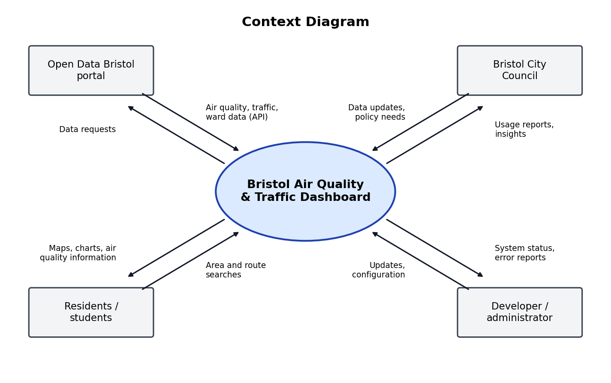

# Project Proposal 
Build a simple web dashboard that turns Bristol's open air quality and traffic data into easy-to-read maps and charts. Residents, students and commuters can see how clean the air is in their area and choose healthier, less congested routes. 
 
### Data Set
Source: Open Data Bristol (opendata.bristol.gov.uk), published by Bristol City Council under an open licence. The portal offers an API for live data.
- **Air quality data:** real-time and historic pollution readings from monitoring sites across Bristol
- **Traffic and cycle count data:** how busy roads and cycle routes are
- **Ward profiles / Quality of Life survey:** population and resident views by area

The dashboard would combine these so users can compare pollution, traffic and area information in one place.
 
### Problem Statement 
Bristol publishes a lot of environmental data, but it is spread across many datasets and is hard for ordinary people to understand. Residents cannot easily see how polluted their area is or when and where the air is cleaner. As a result, people cannot make informed choices about how and where they travel, and the council has no simple way to see where active travel (walking and cycling) is working. 

### Business Benefits
- Helps residents and students choose healthier routes and travel times
- Gives the council clearer evidence for where to invest in cycle lanes and traffic measures
- Makes better use of data the council already collects and publishes
- Raises public awareness of air quality and its effect on health
- Supports Bristol's smart city and sustainability goals
 
### Options Considered 

| Option | Description | Verdict |
|---|---|---|
| 0. Do nothing | Data stays on the portal as raw tables | Does not solve the problem |
| 1. Basic dashboard | Charts and maps using the portal's built-in tools | Cheap, but limited and not user-friendly |
| 2. Custom web app | Web dashboard that pulls live data through the API | Recommended: good balance of cost and value |
| 3. Web and mobile app with alerts | Option 2 plus push notifications when air quality is poor | Best features, but highest cost; possible phase two |

Existing alternatives: Bristol City Council air quality web pages and the national DEFRA air quality service. These show readings but do not combine air quality with travel and area data, or help people plan routes. 

### Cost
*These are estimates based on assumptions for planning purposes.*

| Option | Setup cost | Yearly running cost | Main items |
|---|---|---|---|
| 0. Do nothing | £0 | £0 | None |
| 1. Basic dashboard | about £2,000 | about £500 | Staff time, portal tools |
| 2. Custom web app | about £15,000 | about £3,000 | Developer time, hosting, testing, maintenance |
| 3. Web and mobile app | about £35,000 | about £8,000 | Developer time, app store fees, hosting, notifications, support |

### Risks

| Risk | Impact | How to reduce it |
|---|---|---|
| Sensors go offline or data has gaps | Inaccurate or missing readings | Show "last updated" time and flag missing data |
| Dataset format changes or the API stops | Dashboard breaks | Monitor the feeds and keep a backup copy of the data |
| Low user adoption | Benefits not achieved | Promote through universities and community groups |
| Privacy concerns | Loss of trust | Do not collect personal location data |
| Budget overrun | Project stops early | Start with option 2 and add features in phases |
| Reliance on the council keeping data open | Loss of data source | Agree data access and use open licences |

### Recommendation
Option 2, the custom web app, because it solves the problem at a reasonable cost. Option 3 can follow once there is evidence that people use it.

### Context Diagram
The system is shown as one process in the centre, with the external parties around it.

| External entity | Sends to the system | Receives from the system |
|---|---|---|
| Open Data Bristol portal | Air quality, traffic and ward data (via API) | Data requests |
| Residents / students | Area and route searches | Maps, charts and air quality information |
| Bristol City Council | Data updates and policy needs | Usage reports and insights |
| Developer / administrator | Updates and configuration | System status and error reports |

### Project Scope
The system of interest is the Bristol air quality and traffic dashboard (Option 2, the custom web app). From the context diagram, the following are **in scope**:

- Receiving air quality, traffic and cycle count, and ward profile data from the Open Data Bristol portal via its API, and sending data requests to it
- Accepting area and route searches from residents and students
- Returning maps, charts and air quality information to residents and students
- Accepting data updates and policy needs from Bristol City Council
- Producing usage reports and insights for Bristol City Council
- Accepting updates and configuration from the developer / administrator
- Sending system status and error reports to the developer / administrator

**Out of scope:** the mobile app and push notifications (Option 3, possible phase two) and collecting any personal location data.

